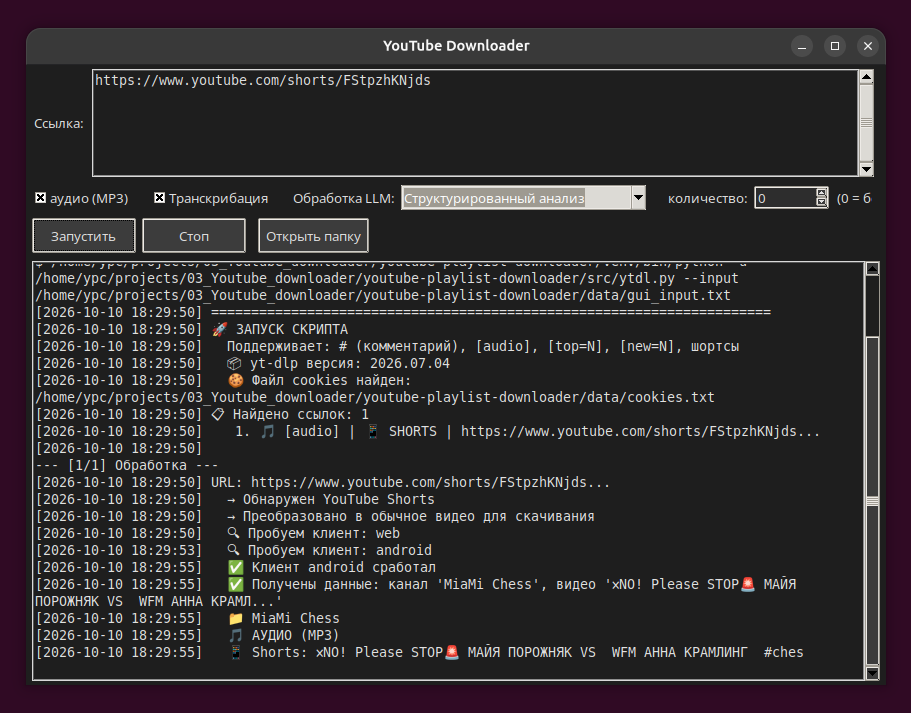

# YouTube Playlist Downloader

Скачивание плейлистов, видео и каналов YouTube с автоматической
транскрибацией, пунктуацией и LLM-обработкой. Графический интерфейс
и CLI, всё в одном проекте.

## Возможности

- 🎬 Скачивание плейлистов YouTube
- 🎵 Режим только аудио (MP3, 192 kbps)
- 📺 Скачивание топ-N или новых N видео с канала
- 📁 Автоматическая структура папок: Канал / Плейлист / видео
- ⏱️ Настраиваемые случайные паузы между видео
- 📝 Логирование всех действий с датами
- 🔄 Пропуск уже скачанных видео
- 📄 Поддержка комментариев и маркеров в playlists.txt
- 🎤 Транскрибация аудио через Vosk
- ✍️ Пунктуация через punctuators
- 🤖 LLM-обработка транскрипций через DeepSeek
- 🖥️ Графический интерфейс (Tkinter)
- ⌨️ CLI для скриптов и автоматизации

## Графический интерфейс



GUI объединяет весь пайплайн обработки в одном окне: от ссылки
на YouTube (или выбора уже скачанного файла) до готового саммари.
Тёмная тема, контекстное меню, авто-логика чекбоксов.

### Режимы работы

| Режим | Что выполняется |
|---|---|
| Ссылка YouTube | ytdl → transcribe → punctuate → summarize |
| Файл из скачанных | transcribe → punctuate → summarize |

### Авто-логика чекбоксов

- Транскрибация → авто включается «Аудио».
- LLM-промпт (кроме «Не обрабатывать») → авто включаются
  «Аудио» и «Транскрибация».
- Снятие «Аудио» → снимает «Транскрибацию» и сбрасывает LLM.

### Элементы UI

- Поле для ссылок (несколько строк = плейлист).
- Кнопка «Выбрать файл» — обработка уже скачанного файла.
- Чекбокс «Аудио» — MP3 вместо MP4.
- Чекбокс «Транскрибация» — Vosk + пунктуация.
- Combobox «Обработка LLM» — выбор промпта.
- Кнопки Запустить / Стоп / Открыть папку.
- Text + Scrollbar — лог.
- Тёмная тема, контекстное меню.

### Запуск GUI

```bash
./run.sh
```

## Быстрый старт

### 1. Клонировать

```bash
git clone git@github.com:bauman-robotics/youtube-playlist-downloader.git
cd youtube-playlist-downloader
```

### 2. Виртуальное окружение и зависимости

```text
python3 -m venv venv
source venv/bin/activate
pip install -r requirements.txt
```

Для транскрибации (Vosk, punctuators) — либо в этот же venv, либо
в отдельный (путь к python — в config.yaml, ключ transcribe_python).

### 3. Настроить

**config.yaml** — пути:

```yaml
download_root: ./data/Video_Youtube
input_file: ./data/playlists.txt
log_file: ./download_log.txt
model_path: ./models/vosk-model-small-ru-0.22
transcribe_python: /path/to/python
venv_path: ./venv
```

**secret_conf.yaml** — ключ DeepSeek (скопировать из примера):

```bash
cp secret_conf.example.yaml secret_conf.yaml
# открой и вставь реальный ключ
```

**prompts.yaml** — 4 промпта для LLM (готовые, можно менять).

### 4. Cookies (для обхода 403)

YouTube может блокировать автоматические запросы (ошибка 403).
Для обхода экспортируйте cookies из браузера в `data/cookies.txt`:

1. Установите расширение для экспорта cookies
   (например, "Get cookies.txt LOCALLY" для Chrome/Firefox).
2. Зайдите на youtube.com в авторизованном браузере.
3. Экспортируйте cookies и сохраните в `data/cookies.txt`.

Если cookies не нужны или не помогают — в CLI есть флаг `--no-cookies`.

### 5. Запуск

```bash
./run.sh          # GUI
./run.sh cli      # CLI
```

## Конфигурация

### config.yaml

| Ключ | Что |
|---|---|
| download_root | Куда скачивать видео/аудио |
| input_file | Файл со ссылками (data/playlists.txt) |
| log_file | Лог (download_log.txt в корне) |
| model_path | Путь к модели Vosk |
| transcribe_python | Python для transcribe/punctuate (если отдельный venv) |
| venv_path | Путь к venv проекта (используется в run.sh) |

### prompts.yaml

| Имя | Описание |
|---|---|
| summary | Краткое содержание + темы + текст |
| summary_short | Только краткое содержание (3 предложения) |
| structured | Детальный анализ: темы, тезисы, цитаты |
| translate_en | Перевод на английский |

### secret_conf.yaml

Секретный файл (в .gitignore):

```yaml
deepseek_api_key: sk-...
base_url: https://api.deepseek.com
```

## Структура проекта

```text
youtube-playlist-downloader/
├── src/                      — исходный код
│   ├── gui.py                — Tkinter GUI
│   ├── ytdl.py               — скачивание с YouTube
│   ├── transcribe.py         — Vosk ASR
│   ├── punctuate.py          — пунктуация
│   └── summarize.py          — DeepSeek LLM
├── scripts/                  — shell-обёртки
│   ├── run_gui.sh
│   └── run_cli.sh
├── data/                     — данные (gitignored)
│   ├── Video_Youtube/        — скачанное
│   ├── playlists.txt         — список ссылок
│   └── cookies.txt           — cookies
├── models/                   — модель Vosk (gitignored, ~88 МБ)
│   └── vosk-model-small-ru-0.22/
├── legacy/                   — старый код
├── docs/images/              — скриншоты
├── config.yaml               — конфиг
├── prompts.yaml              — промпты для LLM
├── secret_conf.example.yaml  — шаблон секретов
├── requirements.txt          — зависимости
├── run.sh                    — запуск (GUI или CLI)
└── README.md
```

## Как это работает

```text
YouTube ссылка  (или файл)
        ↓
  [ ytdl.py ]               — скачивание mp3 / mp4
        ↓
  [ transcribe.py ]         — Vosk: mp3 → txt
        ↓
  [ punctuate.py ]          — пунктуация: txt → _punctuated.txt
        ↓
  [ summarize.py ]          — DeepSeek: _punctuated.txt → _summary.md
```

Артефакты на каждое видео:

- `.mp3` — аудио.
- `.txt` — транскрипция (Vosk).
- `_punctuated.txt` — пунктуация.
- `_summary.md` — LLM-обработка.

## Формат playlists.txt

Поддерживаются маркеры:

| Маркер | Действие |
|---|---|
| `[audio]` | Скачать только аудио (MP3) |
| `[top=N]` | N самых популярных видео с канала |
| `[new=N]` | N самых новых видео с канала |
| `#` в начале | Комментарий, строка игнорируется |

Пример:

```text
# Плейлист
https://www.youtube.com/watch?v=Fp_XNuGw_-A&list=PLDEqjJUrvNYx90e5ahb3GdjAVL-20dM7W

# Только аудио
[audio] https://www.youtube.com/watch?v=cb7Pc4g_d3Y

# Топ-10 с канала
[top=10] https://www.youtube.com/@Sergey_chess
```

## Требования

- Python 3.10+
- yt-dlp — скачивание
- ffmpeg — конвертация mp3 → wav (для Vosk)
- Vosk-модель vosk-model-small-ru-0.22 (~88 МБ)
  — https://alphacephei.com/vosk/models
- PyYAML — для config.yaml и prompts.yaml
- DeepSeek API-ключ — для LLM-обработки
- vosk, punctuators — для транскрибации и пунктуации
  (отдельный venv допустим, путь — в config.yaml)

### Установка ffmpeg

```bash
sudo apt install ffmpeg
```

### Скачивание модели Vosk

```bash
wget https://alphacephei.com/vosk/models/vosk-model-small-ru-0.22.zip
unzip vosk-model-small-ru-0.22.zip -d models/
```

## Лицензия

MIT

## Благодарности

- yt-dlp (https://github.com/yt-dlp/yt-dlp) — скачивание с YouTube
- Vosk (https://alphacephei.com/vosk/) — распознавание речи
- punctuators — пунктуация
- DeepSeek (https://www.deepseek.com/) — LLM-обработка

## Примечание

Скачивайте только публичный контент, к которому у вас есть
законный доступ. Не используйте для нарушения авторских прав.
